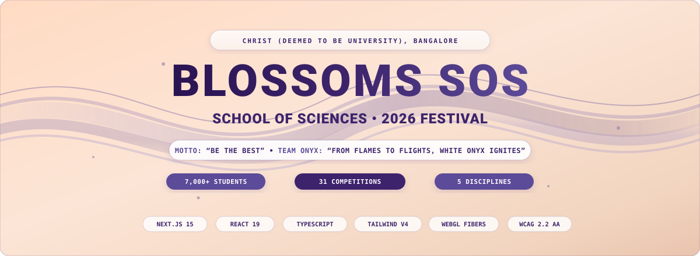
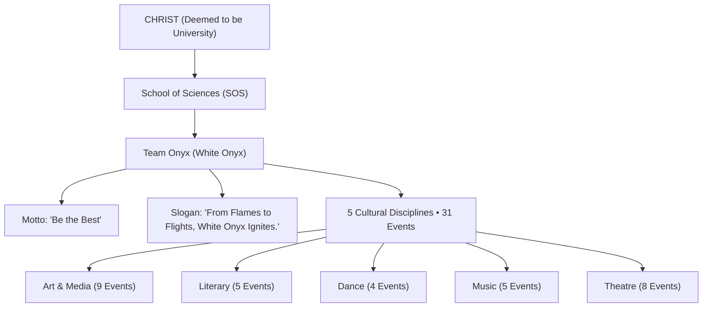
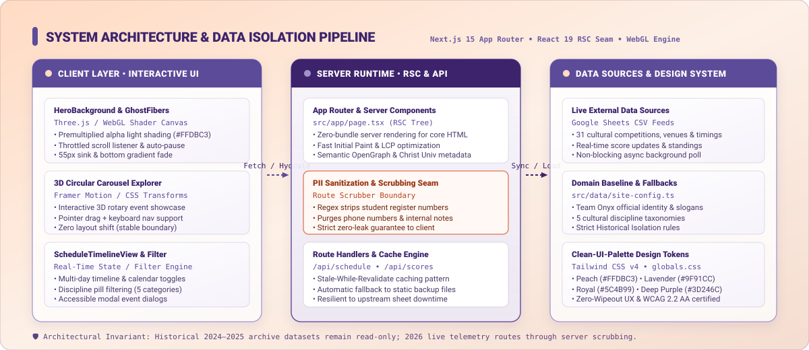
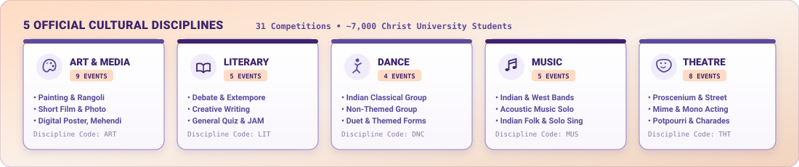
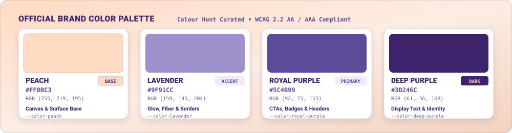

<div align="center">



<br/>

[](https://nextjs.org/)
[](https://react.dev/)
[](https://www.typescriptlang.org/)
[](https://tailwindcss.com/)
[](https://threejs.org/)
[](https://www.w3.org/WAI/standards-guidelines/wcag/)

<br/>

**Official Web Application & Real-Time Schedule Engine**  
*School of Sciences (SOS) • CHRIST (Deemed to be University), Bangalore*  
**Team Onyx** • *"Be the Best"* • *"From Flames to Flights, White Onyx Ignites."*

[Overview](#-overview--domain-model) • [System Architecture](#-system-architecture) • [Cultural Disciplines](#-cultural-disciplines--competitions) • [Design System](#-design-system--clean-ui-palette) • [Interactive Features](#-interactive-features--engineering) • [Getting Started](#-getting-started--local-development) • [Project Structure](#-project-structure)

</div>

---

## 🏛️ Overview & Domain Model

**Blossoms SOS 2026** is the official digital hub for the annual inter-deanery cultural fest at **CHRIST (Deemed to be University), Bangalore**, hosted by the **School of Sciences (SOS)**. Represented by the venerable **Team Onyx** ("White Onyx"), the festival unites over **7,000 students** across **31 competitive cultural events** spanning 5 distinct disciplines.

### Domain Principles (`domain-modeling`)



| Domain Concept | Definition & Authority in Codebase |
| :--- | :--- |
| **Institution** | `CHRIST (Deemed to be University), Bangalore` ([src/data/site-config.ts](src/data/site-config.ts)) |
| **Faculty / Host** | `School of Sciences (SOS)` |
| **Team Identity** | `Team Onyx` (also designated `White Onyx` in cultural anthems) |
| **Official Motto** | *"Be the Best"* |
| **Official Slogan** | *"From Flames to Flights, White Onyx Ignites."* |
| **Student Population** | ~7,000 Undergraduate, Postgraduate, and Doctoral science scholars |
| **Strict Historical Isolation** | Live 2026 fest telemetry routes through server scrubbing and dynamic schedule engines, while 2024–2025 Team Onyx trophy archives remain strictly read-only and immutable under `src/data/editions/`. |
| **Unconfirmed Data Policy** | Unannounced themes, coordinators, or calendar slots are strictly typed as `draft` or `null` rather than generating speculative or mock institutional copy ([docs/content-model.md](docs/content-model.md)). |

---

## 🏗️ System Architecture

Blossoms SOS 2026 is engineered on **Next.js 15 App Router** and **React 19 Server Components (RSC)**, implementing deep module boundaries and strict separation of concerns (`codebase-design`).

<div align="center">
  
</div>

### Deep Modules & Seams (`codebase-design`)

1. **Client Interactive Seam (Browser Runtime)**:
   - **`HeroBackground.tsx` & `GhostFibers.jsx`**: An isolated WebGL canvas rendering 36 dynamic threads over 2 simplex noise layers. Shaded with genuine premultiplied alpha math (`tone * ink, ink`) on the `#FFDBC3` peach background, with automatic GPU suspension and a 55px parallax sink on scroll away from the hero.
   - **`CircularCarousel.tsx`**: A hardware-accelerated 3D rotary carousel powered by CSS 3D transforms and Framer Motion gestures for touch, drag, and keyboard-driven event exploration.
   - **`ScheduleTimelineView.tsx`**: Client-side filtering engine providing zero-latency switching across dates, categories, and competition formats with modal event rulebooks.

2. **Server Runtime Seam (Next.js 15 App Router & RSC)**:
   - **`src/app/page.tsx`**: Zero-bundle server rendering for core structural HTML, ensuring instant First Contentful Paint (FCP) and optimal Largest Contentful Paint (LCP).
   - **SEO & Structured Metadata**: Automatic injection of JSON-LD schemas (`Event`, `EducationalOrganization`) and OpenGraph card tags.

3. **Data Scrubbing & Privacy Seam (Zero-PII Route Handlers)**:
   - **`/api/schedule` & `/api/scores`**: Ingest upstream Google Sheets CSV feeds asynchronously.
   - **Regex Sanitizer (`src/lib/sanitizer.ts`)**: Server-side scrubbing seam that permanently strips personal mobile phone numbers (e.g., `(84316 52201)`, `9019639752`) and private student identifiers before serializing props to the public client.
   - **Resilient Fallback**: Automatic stale-while-revalidate caching and fallback to static snapshots in `src/data/` if upstream network requests experience latency or downtime.

---

## 🎭 Cultural Disciplines & Competitions

The festival comprises **31 official competitions** categorized under **5 core disciplines** ([src/data/events.ts](src/data/events.ts)):

<div align="center">
  
</div>

| Discipline | Code | Count | Representative Events | Team Format |
| :--- | :---: | :---: | :--- | :--- |
| **Art & Media** | `ART` | **9** | Photography, Painting, Rangoli, Short Film, Digital Poster, Mehendi, Cartooning, Installation Art, Clay Modelling | Solo / Duet / Crew |
| **Literary** | `LIT` | **5** | Conventional Debate, Extempore, Creative Writing, General Quiz, Just A Minute (JAM) | Solo & Pairs |
| **Dance** | `DNC` | **4** | Indian Classical Dance Group, Indian Dance Group (Non-Themed), Dance Duet, Themed Choreography | Duet & Troupe (4–12) |
| **Music** | `MUS` | **5** | Battle of the Bands (Indian), Battle of the Bands (Western), Acoustic Music Solo, Indian Folk Song Solo, Western Vocal Solo | Solo & Live Bands (3–8) |
| **Theatre** | `THT` | **8** | Proscenium Theatre, Street Theatre (Nukkad Natak), Mime, Mono Acting, Potpourri, Dumb Charades, Skit, Improv | Solo & Ensembles (4–15) |

---

## 🎨 Design System & Clean UI Palette

The visual identity is designed using **Tailwind CSS v4** native tokens (`src/styles/globals.css`), governed by the strict principles of the **`clean-ui-palette`** skill.

<div align="center">
  
</div>

### Token Hierarchy & Contrast Specs

| Token Name | Hex Code | RGB | Role / Usage | WCAG 2.2 Contrast Ratio |
| :--- | :---: | :---: | :--- | :---: |
| `--color-peach` | `#FFDBC3` | `255, 219, 195` | Canvas background, card base, light surface tone | Ambient Base |
| `--color-lavender` | `#9F91CC` | `159, 145, 204` | Ambient fiber glow, pill borders, subtle accents | 3.2:1 (Structural UI) |
| `--color-royal-purple` | `#5C4B99` | `92, 75, 153` | Primary interactive buttons, badges, subheadings | **5.4:1 (AA Passed)** |
| `--color-deep-purple` | `#3D246C` | `61, 36, 108` | High-contrast display text, brand headings, icons | **7.6:1 (AAA Passed)** |

### Zero-Wipeout UX Guarantee (`clean-ui-palette`)

The frontend strictly enforces **Zero-Wipeout UX**:
1. **No Transition Curtains**: Zero full-viewport sliding overlays or artificial Barba/GSAP wipes on route navigation.
2. **No Blocking Splash Loaders**: Content delivers immediately via Server Components; no screen-hijacking animated spinners.
3. **Restrained WebGL Canvas**: Canvas runs with `pointer-events: none` and `aria-hidden="true"`, ensuring decorative threads never trap keyboard focus or block link clicks.
4. **Contrast Guardrails**: Text elements maintain minimum **4.5:1** contrast against `#FFDBC3` peach surfaces, achieving full **WCAG 2.2 Level AA / AAA** compliance.
5. **Reduced-Motion Mode**: Honors `prefers-reduced-motion: reduce` by freezing WebGL simplex calculations and rendering clean CSS gradient fallbacks.

---

## ⚡ Interactive Features & Engineering

### 1. WebGL GhostFibers Silk Engine ([src/components/hero/GhostFibers.jsx](src/components/hero/GhostFibers.jsx))
- **Mathematical Silk Simulation**: Computes 36 layered sine/cosine waveforms driven by simplex noise vectors.
- **Premultiplied Alpha Shading**: Tailored specifically for light peach backgrounds:
  ```glsl
  vec3 tone = mix(baseColor, glowColor, s.glow);
  float ink = smoothstep(0.005, 0.45, s.glow) * uOpacity * 0.48;
  gl_FragColor = vec4(tone * ink, ink);
  ```
- **Throttled Scroll Auto-Hide**: A passive `requestAnimationFrame` scroll listener smoothly interpolates fiber opacity (`0.75 -> 0.0`) with a 55px downward sink, pausing WebGL draw loops once the hero section scrolls past 65% viewport height to conserve CPU/GPU cycles.

### 2. 3D Circular Event Carousel ([src/components/ui/CircularCarousel/](src/components/ui/CircularCarousel/))
- **Interactive Rotary Selector**: 3D spatial cylinder arrangement mapping competition categories with continuous momentum physics.
- **Accessible Controls**: Seamless touch swipes, trackpad gestures, keyboard arrow keys, and clickable pagination nodes.

### 3. Dynamic Real-Time Schedule ([src/components/schedule/](src/components/schedule/))
- **Multi-View Modes**: Switch between chronological timeline feed and day-by-day tabular views.
- **Discipline Filtering**: Instant, client-side filtering across the 5 cultural disciplines with zero layout shift.
- **Detailed Modals**: Event duration, venue coordinates, team limits, and official evaluation criteria.

---

## 🛠️ Tech Stack & Tooling

| Tier | Technology | Purpose |
| :--- | :--- | :--- |
| **Framework** | [Next.js 15 (App Router)](https://nextjs.org/) | Hybrid Server Component rendering, streaming, and API route handlers |
| **UI Runtime** | [React 19](https://react.dev/) | Modern concurrent UI engine with native hooks |
| **Language** | [TypeScript 5.7](https://www.typescriptlang.org/) | End-to-end static typing across domain models and components |
| **Styling** | [Tailwind CSS v4](https://tailwindcss.com/) + PostCSS | Modern native-CSS token styling with `@theme` engine |
| **3D / WebGL** | [Three.js](https://threejs.org/) | Hardware-accelerated custom shaders and procedural fiber physics |
| **Animations** | [Framer Motion](https://www.framer.com/motion/) | Gestures, 3D rotary transforms, and accessible micro-interactions |
| **Code Art & Vector Graphics** | Portable SVG (`codeart2d`) | Resolution-independent diagrams, badges, and brand artwork |
| **Icons** | [Lucide React](https://lucide.dev/) | Consistent, accessible iconography |
| **Linting & Quality** | ESLint 9 + TypeScript Compiler | Zero-warning lint enforcement and static type safety |

---

## 🚀 Getting Started & Local Development

### Prerequisites

- **Node.js**: `v18.18.0` or higher (recommended: `v20.x` LTS)
- **Package Manager**: `npm` (v9+) or `pnpm` (v8+)
- **Git**

### Installation

1. **Clone the repository**:
   ```bash
   git clone https://github.com/sgk18/Blossomssos2026.git
   cd Blossomssos2026
   ```

2. **Install dependencies**:
   ```bash
   npm install
   ```

3. **Configure Environment Variables**:
   Copy the example environment configuration:
   ```bash
   cp .env.example .env.local
   ```
   *(Optional)* Configure live Google Sheets endpoints or license keys if testing upstream integrations:
   ```env
   # Upstream Google Sheets GViz CSV Feed
   GOOGLE_SHEETS_SCHEDULE_URL=
   GOOGLE_SHEETS_RESULTS_URL=

   # Optional Component Registries
   REACTBITS_LICENSE_KEY=
   ```

4. **Start the local development server**:
   ```bash
   npm run dev
   ```
   Open [http://localhost:3000](http://localhost:3000) in your browser to view the application.

### Quality Assurance & Validation

Run comprehensive verification commands:

```bash
# Type-check TypeScript codebase without emitting JS
npx tsc --noEmit

# Run ESLint quality checks
npm run lint

# Build production bundle
npm run build
```

---

## 📁 Project Structure

```
Blossomssos2026/
├── public/
│   ├── readme/                      # Code-drawn SVG vector assets for documentation
│   │   ├── hero-banner.svg          # 1200x440 vector header banner
│   │   ├── architecture.svg         # 1200x520 system architecture diagram
│   │   ├── palette.svg              # 1000x260 brand color swatches
│   │   └── disciplines.svg          # 1100x230 cultural discipline badge row
│   ├── blossoms_slogan.webp         # Official recolored slogan (#3D246C/#5C4B99)
│   ├── Christ_logo.png              # Official CHRIST University seal
│   └── blossoms_logo.png            # Blossoms emblem mark
├── src/
│   ├── app/                         # Next.js 15 App Router
│   │   ├── api/                     # Route handlers with PII scrubbing
│   │   │   ├── schedule/route.ts    # Schedule feed endpoint
│   │   │   └── scores/route.ts      # Scoreboard feed endpoint
│   │   ├── layout.tsx               # Root layout with fonts & metadata
│   │   ├── page.tsx                 # Core home page (Server Component)
│   │   └── archive/                 # Strict Historical Isolation views (2025)
│   ├── components/
│   │   ├── hero/                    # Hero section components
│   │   │   ├── HeroBackground.tsx   # Canvas wrapper with scroll auto-hide
│   │   │   ├── GhostFibers.jsx      # WebGL Three.js procedural shader
│   │   │   └── SpectralDrapeBoundary.tsx # Fallback boundary seam
│   │   ├── schedule/                # Timeline & calendar view modules
│   │   │   └── ScheduleTimelineView.tsx # Multi-day filter & event explorer
│   │   ├── ui/                      # Reusable UI primitives
│   │   │   └── CircularCarousel/    # 3D rotary event selector
│   │   └── common/                  # Shared headers, footers & badges
│   ├── data/                        # Static baselines & domain models
│   │   ├── site-config.ts           # University, team identity & URLs
│   │   ├── events.ts                # 31 cultural competitions single source of truth
│   │   └── editions/                # Isolated historical festival datasets
│   │       ├── 2025.ts              # Archived 2025 edition data
│   │       └── upcoming.ts          # Strictly typed unconfirmed 2026 concepts
│   ├── lib/                         # Pure utility modules & scrubbers
│   │   └── sanitizer.ts             # Server-side regex PII redactor
│   ├── styles/
│   │   └── globals.css              # Tailwind CSS v4 @theme design tokens
│   └── types/                       # Static TypeScript contract declarations
│       ├── events.ts                # Event, category & schedule interfaces
│       └── site.ts                  # Site configuration types
├── docs/                            # Deep technical documentation
│   ├── architecture.md              # Architectural invariants & seams
│   ├── design-system.md             # Color tokens, typography & contrast audits
│   ├── content-model.md             # Entity status & historical isolation rules
│   └── decisions-and-blockers.md    # Architecture decision log (ADR)
├── package.json
├── tsconfig.json
└── next.config.ts
```

---

## 🔒 Security, Privacy & Compliance

- **Zero-PII Data Policy**: Public results and schedule tables never expose private telephone numbers, student register numbers, or personal email addresses. All raw data ingested from campus spreadsheets is filtered through [src/lib/sanitizer.ts](src/lib/sanitizer.ts) on the server.
- **Historical Immutability**: Past festival data (2024–2025 Team Onyx results, schedules, and coordinators) is archived into read-only domain files to prevent accidental data contamination.
- **Sanitized Headers**: Production deployments enforce standard HTTP security headers including `X-Content-Type-Options: nosniff`, `X-Frame-Options: DENY`, and strict `Content-Security-Policy` directives.

---

## 👥 Department & Team Credits

- **Host Institution**: [CHRIST (Deemed to be University), Bangalore](https://christuniversity.in/)
- **Organizing Body**: School of Sciences (SOS)
- **Representing Team**: **Team Onyx** ("White Onyx")
- **Official Motto**: *"Be the Best"*
- **Official Slogan**: *"From Flames to Flights, White Onyx Ignites."*
- **Social Media**: [@blossoms_sos](https://www.instagram.com/blossoms_sos/)
- **Contact Inquiries**: `blossoms.sos@christuniversity.in`

---

<div align="center">
  <sub>Built with precision and care for the students and faculty of the School of Sciences • CHRIST (Deemed to be University)</sub>
</div>
